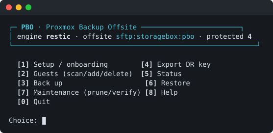
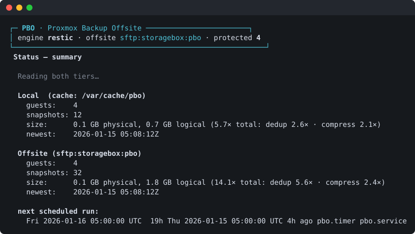

# pbo

This backs up Proxmox guests (LXC and QEMU) to an SFTP server using
[restic](https://restic.net/). That's it. It is not trying to be Proxmox Backup
Server, and if PBS works for you, go use PBS.

The point is an encrypted offsite copy without standing up yet another server for it.
restic already does dedup, encryption and incremental backups over plain SFTP, so pbo
is mostly glue: it runs `vzdump`, throws the archive into a restic repo, and pushes it
offsite. Restore does the reverse and feeds the archive to `pct restore` or
`qmrestore`, always into a new VMID. Drive it from `pbo menu`, the individual
commands, or the Proxmox GUI itself (see [Proxmox GUI](#proxmox-gui)).

> This is beta. It backs up and restores real machines and there's a test suite, but
> things still move around, so don't make it the only copy of anything important just
> yet.

## Screenshots

A quick look at the interface before you clone it (rendered from a demo setup with
made-up guests and data). The main menu:



And the status screen, showing both tiers with the next scheduled run:



## Why restic

restic already solved the hard parts, so there's no reason to reinvent them. It speaks
SFTP itself, so there's no FUSE mount and no rclone in the middle. Everything goes into
one repo no matter how many guests or nodes you have. The repo password is both the
encryption key and the recovery key, so if you lose it the data is gone for good. Keep
a copy somewhere safe.

## Requirements

Nothing exotic:

- A Proxmox host (`pct`, `qm`, `vzdump`).
- `restic` 0.14.0 or newer (`RESTIC_MIN`; a rest-server login needs 0.16.1), `jq`,
  `zstd`, `curl`, `openssl`, `openssh-client`, `acl` (`setfacl`, `getfacl`) and
  `util-linux` (`flock`, `setpriv`, `findmnt`). `install.sh` installs whatever's
  missing and refuses a restic older than the config needs; `pbo doctor` checks both.
- A restic repository: an SFTP target you can log into with a key (Storage Box paths
  are relative because the account is chrooted, which is expected), a rest-server
  (append-only, see below), a local or mounted directory, or any other restic backend
  (S3, B2, Azure, GCS, rclone, ...), whose credentials go in `RESTIC_ENV_FILE`.

## Compatibility

What the test suite and CI cover, and what has not been tested. `pbo doctor --report`
prints the same facts about your host (versions, filesystem, backend types, tools; no
host name, URL, path or secret), for a bug report.

| Area | Tested | Not tested |
|---|---|---|
| Proxmox VE | The Proxmox integration (`pbo integrate`, the storage plugin) needs pve-manager >= 9.2.29 and libpve-storage-perl >= 9.1.18 (install.sh checks them); `tests/integration/` runs on a real PVE 9.2 host. CI runs every suite against mocks of `pct`, `qm`, `vzdump`, `pvesh`, `pvesm` and stub PVE perl modules. | PVE 8 and older. Standalone mode only uses `pct`, `qm` and `vzdump` and may work there, but no release is tested on it. |
| restic | CI pins one release (see `.github/workflows/ci.yml`); the suites use real local repositories. | Versions between `RESTIC_MIN` (0.14.0) and the pinned one: the minimum comes from the features pbo uses (ADR 0009, "Portability"), not from a test run. |
| Install layouts | Both: install.sh (`/usr/local/lib/pbo`) and the .deb (`/usr/lib/pbo`); every systemd unit is checked in each layout. | Other prefixes. |
| CACHE_DIR filesystem | ext4-like filesystems with POSIX ACLs, a filesystem without ACL support (mocked), the ACL mask, an unprivileged CT's mapped root passing the parents (as root). | ZFS with `acltype=posixacl`, btrfs and xfs on real hardware; NFS and CIFS (not refused yet, but ACLs and renames there are untested). |
| Backends | Local directory repositories (real restic). `tests/integration/pve.sh` runs backup, restore and prune on a PVE host and, with a janitor, the append-only path against a real rest-server. `RESTIC_ENV_FILE` is checked to reach restic and nothing else. | SFTP servers (the wizard's ssh command is tested, a transfer is not), S3, B2, Azure, GCS, rclone and the other restic backends against real services. |
| Clusters | Which node backs up which guest, from mocked cluster views; the cluster-shared config (`/etc/pve/pbo/config`); per-node storage ids, `pbo integrate` and job ownership with a mocked member list of one and three nodes. | A real multi-node cluster. |
| Time zones | Archive names, the catalogue's times and the timers' next run under UTC, +05:30 and -03:00; retention, which restic plans by the local day each snapshot recorded, with snapshots taken in each of those zones. | Daylight-saving transitions. |
| Users | The suites run as a plain user in CI; run as root they also cover owners, `setpriv` and `chown`. | |

## Install

```bash
git clone https://github.com/TubalQ/PBO
cd PBO
sudo ./install.sh
```

Goes into `/usr/local` and offers to run setup. It leaves the timer off, so it won't
start a nightly job you didn't ask for.

Or use the package from a [release](https://github.com/TubalQ/PBO/releases) (built by
CI, `packaging/build-deb.sh` builds the same locally):

```bash
apt install ./pbo_<version>_all.deb    # pulls restic, jq, zstd, ...
pbo setup
```

It installs to `/usr/lib/pbo`, ships the timers disabled, and leaves `/etc/pbo` alone
on purge (the DR key lives there). Releases are signed tags; see `CHANGELOG.md`.

## Quick start

```bash
pbo setup     # everything, in one pass
```

`setup` is a single guided pass that gets you from a clean clone to running backups.
It generates an SSH key if you don't have one and shows you how to install it on the
target, pins the target's host key, tests the SFTP connection before it commits
anything, writes `/etc/pbo/config`, creates the repo, sets retention, confirms which
guests to back up, and offers to enable the four timers (nightly backup, weekly prune,
weekly verify slice, weekly restore test). It never overwrites an existing DR key.

The one thing it can't do for you is get the public key onto the target — it prints the
key and the exact command, you run that once, and the connection test confirms it took.

Afterwards, export the DR key somewhere safe (`pbo menu` → Export DR key). Don't skip
that: it's the only thing that can decrypt the offsite data.

If you'd rather enable the schedule by hand instead of from the wizard:

```bash
systemctl enable --now pbo.timer               # backups, 05:00 daily
systemctl enable --now pbo-prune.timer         # prune, Sunday 06:30
systemctl enable --now pbo-verify.timer        # verify slice, Wednesday 10:00
systemctl enable --now pbo-test-restore.timer  # restore test, Saturday 10:00
```

Then `pbo doctor` any time to check the repo is reachable, the timer is on, the
DR key is 0600, the last integrity check passed, the config has no unknown keys, and
every guest has a recent snapshot. It also checks the permissions of pbo's
directories and files against one table (CACHE_DIR closed with an ACL entry per
unprivileged CT, the directories above it passable by the CTs' mapped root,
staging, locks, logs, state, config, secrets; ADR 0009). `pbo doctor --fix`
applies that table (`--dry-run` lists the changes first; each change is in the
audit log); `--fix-parents` also adds a traverse-only ACL entry to a directory
above CACHE_DIR that blocks a CT.

## Notifications

`NOTIFY_LEVEL` decides what is sent: `fail` (default) only failures, `warn` also
warnings (a test-restore throwaway left behind, an old key still valid on an
append-only offsite after `rotate-key`), `all` also every successful run.
(`NTFY_ON_SUCCESS=true` from older configs still works and means `all`.) Two ways out:

- **Proxmox's notification system** (default when no ntfy is set up). pbo hands its
  events to the same targets and matchers as the cluster's own alerts, so they end up
  wherever those go: mail, Gotify, a webhook. Failures are severity `error`, and every
  event has the fields `type=pbo` and `hostname=<node>`, so a matcher with
  `match-field exact:type=pbo` can route them separately. `install.sh` puts pbo's
  templates in `/etc/pve/notification-templates/default/` (cluster-wide).
- **ntfy**, with `NTFY_URL`/`NTFY_TOPIC` (or `/etc/ntfy.creds`).

`NOTIFY_PVE=true` uses both, `false` only ntfy. `pbo notify-test` sends one warning
through whatever is active, and `doctor` warns if nothing would alert at all.

## Metrics and audit log

pbo writes a Prometheus textfile after every run-schedule, verify, prune and
manual backup, to `METRICS_FILE` (default `/var/lib/pbo/pbo.prom`). Point it into
node_exporter's textfile directory and it gets scraped with everything else:

```bash
METRICS_FILE=/var/lib/prometheus/node-exporter/pbo.prom
```

Per guest it reports the newest snapshot's time, duration, archive size and bytes
added (read from the snapshot summaries restic already keeps, so nothing extra runs
during the backup), plus snapshot counts, whether the repo answered, and the last
run-schedule/verify/prune with success, duration and failed guests. `pbo metrics`
prints the same. A useful alert:

```
time() - pbo_guest_last_backup_timestamp_seconds > 36*3600
```

Every pbo command also lands in `LOG_DIR/audit.jsonl`, one JSON object per line:
who ran it (`SUDO_USER` or the user), the arguments, node, exit code, duration, and
whether it only read. Restores and test-restores add an event line with the details.
The file is 0600 and logrotate keeps two years of it.

```bash
jq -c 'select(.read_only==false) | {time,user,command,args,exit}' /var/log/pbo/audit.jsonl
```

## Per-guest policy

Set it on the guest in Proxmox, as tags (GUI, or `pct set <id> --tags "..."`), and it
follows the guest when it moves to another node:

| Tag | Effect |
|---|---|
| `pbo-skip` | Left out of the nightly run. `pbo backup <id>` still works, with a warning. `doctor` lists it as skipped. |
| `pbo-stop` | vzdump `--mode stop` for this guest, like `VZDUMP_STOP_VMIDS`. |
| `pbo-keep-daily-N` | Offsite retention for this guest. Any subset of daily/weekly/monthly/yearly; |
| `pbo-keep-weekly-N` | the rest come from `KEEP_OFFSITE_*`. |
| `pbo-keep-monthly-N` | |
| `pbo-keep-yearly-N` | |

The keep tags are copied into each snapshot (`keep=d30.m12`), and prune reads them
from there. So a janitor that can't see Proxmox applies them too, and they still hold
after the guest is destroyed. The newest snapshot decides: change a tag and it counts
from the next backup. A policy that adds up to nothing keeps the newest snapshot
rather than deleting them all. The cache tier stays on `KEEP_LOCAL`.

## Integrity checks

`restic check` alone only checks structure. Reading the data back is what catches
bit rot or a provider quietly losing a pack, and reading all of it over SFTP every
week is expensive. `pbo verify --scheduled` reads the next 1/`VERIFY_ROTATE` slice
each run instead, so with the default of 12 and the weekly `pbo-verify.timer` every
pack is read about once a quarter. A failed slice is read again next time. `doctor`
shows when the last verify ran and fails if it failed.

```bash
systemctl enable --now pbo-verify.timer   # Wed 10:00
```

On a janitor the same runs daily against local disk (`VERIFY_ROTATE=30`).

## Restore tests

Verify proves the bytes are intact; only a restore proves the guest comes back.
`pbo test-restore <vmid>` restores the newest snapshot to a throwaway vmid
(9000-9099, free cluster-wide, locked while in use) with its network removed,
autostart off and nothing bound to the host, boots it, waits until it answers, and
destroys it. "Answers" means `pct exec` works for a container and the qemu guest
agent replies for a VM; a VM without a configured agent can only be proven to be
running, and the record says so (`respond_check: "running"`).

`pbo-test-restore.timer` runs `test-restore --scheduled` every Saturday,
`TR_PER_RUN` guests per run, in this order: a guest whose latest test failed (at most
one per run), then never-tested guests, then the one tested longest ago. With one guest a week, a dozen guests are each tested about
once a quarter.

```bash
systemctl enable --now pbo-test-restore.timer   # Sat 10:00
pbo restore-report                             # the evidence, last 90 days
pbo --json restore-report --days 365
```

Every test, manual or scheduled, is appended to `/var/lib/pbo/restore-tests.jsonl`
(not rotated): which guest, which snapshot (id, time, age, repo tier), where it was
restored, and each stage (fetch, restore, start, respond, cleanup) with its duration
and result. After each test `/var/lib/pbo/restore-report.{json,txt}` is rewritten with
the history of the window plus coverage: guests tested OK, guests whose latest test
failed, guests never tested. That file is the one to hand an auditor.

A failed test alerts like any failure and stays a `doctor` FAIL until that guest
passes again (`pbo test-restore <vmid>`). `doctor` also warns when the last test is
older than `TR_MAX_AGE` (21 days) and when a throwaway guest was left behind by a
crash (they are tagged `pbo-throwaway`). Metrics:
`pbo_guest_last_test_restore_{timestamp_seconds,success,duration_seconds}` per guest.

The throwaway needs room on `TR_STORAGE` (default: the first active storage for that
guest type) and the archive is extracted under `CACHE_DIR` first, so plan for the
biggest guest twice.

## Clusters

There's no cluster mode to set up. Install it on every node and each node backs up its
own guests into the same repo, the same way Proxmox's own backup jobs work. No
coordinator, no node reaching across to another over SSH.

```bash
sudo ./install.sh
pbo setup                            # same repo, same password
systemctl enable --now pbo.timer
```

With `BACKUP_ORDER=auto` each node works out its own guests. Move a guest to another
node and that node backs it up on the next run; restic tags snapshots by vmid, so the
history isn't lost.

A few things worth getting right:

- Use the same repo password on every node, in `/etc/pbo/restic-pass`. Keep it out of
  `/etc/pve`, since pmxcfs replicates that directory in cleartext, which defeats the
  point.
- To edit the config once instead of N times, put the non-secret parts in
  `/etc/pve/pbo/config` and let pmxcfs sync it. The local file still holds the password
  and wins on conflicts.
- Prune from one node only, since it takes an exclusive lock. Set `PRUNE_OWNER` to pin
  it to a node.
- Give the nodes different backup times (`pbo config set SCHEDULE_BACKUP "*-*-*
  03:00:00"` on one, another time on the next): they share one repo, and restic's
  lock and the uplink are shared too. The schedule is per node: `--shared` writes it
  for every node, but only the node that ran the command gets its timer updated; the
  others pick it up with `pbo timers apply` (doctor names the difference).
- With the Proxmox integration each node gets its own pbo storage, `pbo-<node>`,
  limited to that node (`--nodes <node>`) and pointing at that node's spool:
  storage.cfg is one file for the whole cluster, and a storage has one path. A
  single node keeps the id `pbo`. Create the Proxmox backup jobs per node, each on
  its node's storage (`Node: <node>`, `Storage: pbo-<node>`): a job for all nodes on
  one node's storage fails on the others, and pbo does not count it as backing up
  their guests. A cluster that turned the integration on before 0.6 keeps its
  `pbo` storage; doctor suggests the move (see RUNBOOK, "Clusters"). `PVE_STORAGE_ID`
  is per node: the cluster-shared config cannot set it.

## Commands

```
pbo [global flags] <command> [arguments]

Global flags:
  --json              machine-readable output
  --dry-run           show what would happen, do nothing

Commands:
  setup                       setup wizard
  menu                        interactive prompt
  init                        create or verify the repo
  backup [--queue] <vmid>     back up one guest (--queue: wait for the lock instead of failing)
  preflight <vmid>            run the preflight checks only
  run-schedule [--stream|--batch]   back up this node's guests
  status                      lock holders and recent job logs (--json: also the active jobs)
  job start <command> [args]  run an action in the background, prints the job id
  job list [--limit N] | show <id> | log <id> [--from N] [--follow] | cancel <id>
  policy get <vmid>           a guest's pbo policy (skip, stop mode, own retention)
  policy set <vmid> [--skip on|off] [--stop on|off] [--keep d30.w8.m12.y2|default]
  doctor [--fix [--fix-parents]] [--perms-only]
                              health check (repo, timer and its schedule, restic version, permissions,
                              alerts, verify, per-guest age); --fix applies the permission table and
                              the timer drop-ins first
  doctor --report             the environment for a bug report (no host name, URL, path or secret)
  guests                      every guest: policy, newest snapshot, staleness, last restore test
  timers                      the pbo timers: enabled, schedule and its source, next and last run,
                              last result
  timers apply                write the timers' schedule drop-ins from the config (SCHEDULE_*)
  config [show]               the effective configuration (secrets never shown)
  version                     pbo, restic and JSON contract versions
  notify-test                 send a test alert through every active backend
  metrics [--no-write]        Prometheus metrics (also rewrites METRICS_FILE)
  list [--reasons] [vmid]     snapshots in the read repo (--reasons: why each is kept)
  usage                       repo size, dedup ratio, snapshot count
  fetch <vmid> <ts>           extract+verify a snapshot into the cache
  restore <vmid> <ts> --to N [--storage S] [--yes] [--start] [--keep-network]
                              restore to a new vmid (without --yes: only the plan); the copy
                              is isolated unless --keep-network (disaster recovery, refused
                              while the original exists)
  verify [--scheduled]        restic integrity check (both tiers); --scheduled reads 1/N of the data
  prune [--if-owner] [--queue] apply retention (--queue: wait for a running backup)
  unlock                      clear a stale repo lock after a killed run
  rotate-key <file>           rotate the repo password to a new value
  test-restore <vmid>         restore to a throwaway vmid, boot, destroy (recorded as evidence)
  test-restore --scheduled    test the guest that went longest without a test
  restore-report [--days N]   restore-test history and coverage per guest
  backup-host                 back up this host's config + rebuild metadata
  restore-host <node> <ts> --to <dir> [--path <p>]   extract host files to a new or empty dir
  integrate status | enable <both|integrated> [--catalog-only] [--yes] | disable [--yes]
                              the Proxmox integration (see Proxmox GUI)
  catalog refresh | show | release [--all]    the index the Proxmox storage plugin reads
  ingest --pending            finish Proxmox job uploads that failed (spool leftovers, offsite copies)
  help                        this list

Exit codes: 0 ok, 64 usage, 65 bad data, 69 unavailable (e.g. doctor found problems),
70 internal error, 73 cannot create, 75 busy (lock held or queued), 78 config error.
```

## JSON output

With `--json` every command prints exactly one JSON object on stdout (logs go to
stderr), so scripts never parse human text (`metrics` puts the
Prometheus text in `text`, `help` the usage in `usage`). Every object has:

```json
{"schema": 1, "command": "doctor", "status": "ok", "ok": true, "dry_run": false, ...}
```

- `schema` is the contract version. A breaking change bumps it and is listed in
  the CHANGELOG.
- The read views use real types (numbers, booleans, arrays, null): `doctor`
  (`problems`, `warnings`, `findings: [{level, message, vmid}]`), `guests`,
  `timers`, `config`, `status`, `list`, `usage`, `version`, `restore-report`.
  A vmid is always a string (host backups are `host-<node>`).
- Action results (`backup`, `restore`, `verify`, ...) carry string values apart
  from the envelope and the counters.
- A failure that the command did not report itself becomes
  `{"status": "error", "ok": false, "exit": <code>, "error": "<message>"}`, with
  the same exit code.
- `config` never prints a secret (only `"set": true/false`) and masks credentials
  inside URLs.

```bash
pbo --json guests | jq -r '.guests[] | select(.stale) | .vmid'
pbo --json doctor | jq -r '.findings[] | select(.level != "ok") | .message'
```

## Proxmox GUI

On Proxmox VE 9.2.29 or later (libpve-storage-perl 9.1.18) pbo can also show up
in the Proxmox GUI as a storage of type `pbo` (ADR 0006, ADR 0007). You choose at
install time:

| `install.sh --integration` | Who backs up a guest |
|---|---|
| `standalone` (default) | `pbo.timer`, as before; nothing in the Proxmox GUI |
| `both` | a Proxmox backup job to the pbo storage, if one selects the guest; `pbo.timer` the rest |
| `integrated` | only Proxmox backup jobs (doctor fails on a guest no job selects) |

`install.sh` installs the storage plugin, the vzdump hook and the units (with
.debs: the `pbo-pve-storage` package). It never touches the Proxmox config; once
the repo exists, `pbo integrate` does:

```bash
pbo --dry-run integrate enable both   # what it would change
pbo integrate enable both             # the pbo storage, the hook line in /etc/vzdump.conf, pbo-catalog.timer
pbo integrate enable both --catalog-only   # browse and restore only, no backup target
pbo integrate status                  # mode, storage, hook, spool, jobs, who owns which guest
pbo integrate disable                 # back to standalone (refused while a Proxmox job targets pbo)
```

The storage is called `pbo` on a single node and `pbo-<node>` in a cluster (see
[Clusters](#clusters)); `PVE_STORAGE_ID` sets another id. `pbo integrate status` and
`pbo config get PVE_STORAGE_ID` show the one in use.

In the GUI, under the `pbo` storage:

- **Backups** lists every snapshot in the cache and offsite repos (the catalogue
  is refreshed every 15 minutes and after each backup).
- **Show Configuration** and **Restore** work on any of them. A cache archive is
  served through a read-only `restic mount` of the cache repo (`pbo-mount.service`,
  started on demand); an offsite-only one is copied out with `restic dump` first,
  so the GUI may ask you to retry after a few minutes.
- **Backup now** and **backup jobs** to `pbo` write to a spool; the hook hands each
  archive to `pbo ingest`, which uploads it to both repos before the job counts as
  done. Set compression to none (restic compresses and deduplicates) and use stop
  mode for guests that need it (fuse, the `pbo-stop` tag); the hook refuses
  anything else.
- **Remove**, **Prune** and **Protection** are refused: retention belongs to pbo
  (`pbo prune`, the `pbo-keep-*` tags). Notes are not stored.
- The per-guest policy is plain Proxmox tags (`pbo-skip`, `pbo-stop`,
  `pbo-keep-*`, see [Per-guest policy](#per-guest-policy)), so it can be edited on the
  guest in the GUI as well.

A restore from the GUI is a normal Proxmox restore: the copy keeps the original's
network, its bind mounts (root only: Proxmox refuses anyone else) and its
`onboot` setting, so do not start it next to the original (and clear "Start at
boot" before the host reboots). A volume excluded from the backup (`backup=0`)
comes back empty. A restore from a guest's own Backup tab replaces that guest in
place. `pbo restore`
stays the isolated way (network disconnected, host bindings removed). Keep the
`pbo` storage's permissions to administrators; doctor warns about anyone else.

pbo 0.4 had its own web UI (`pbo-web`, port 8008). It was removed in 0.5.0: the
Proxmox GUI and the CLI cover it. `install.sh` removes an old pbo-web; with .debs
the `pbo` package breaks `pbo-web`, so apt removes it. Close TCP 8008 afterwards.

## Jobs

Long actions can run in the background and be followed from anywhere:

```bash
pbo job start backup 101          # prints the job id, returns at once
pbo job list
pbo job log 42 --follow
pbo job cancel 42
pbo --json job log 42 --from 120  # new lines since line 120 (for polling)
```

Each job runs as a transient systemd unit (`pbo-job-<id>`), so it survives a
closed terminal, and takes the same locks as on the command line:
a backup job started while the nightly run is busy waits for it and shows as
`queued`. The job's log, exit code and the command's JSON result stay in
`/var/lib/pbo/runs/<id>/` (the newest `JOB_KEEP`, default 200).

## Backing up the host itself

`pbo backup-host` captures the Proxmox host's own configuration into the same
repo, tagged `type=host`, so a rebuild is not starting from a blank machine. It
stores a curated set of paths (`/etc/pve`, networking, `/etc/pbo`, systemd units,
cron, apt sources — see `HOST_BACKUP_PATHS`) plus collected rebuild metadata
(`pveversion -v`, the manual package list, storage and network layout). It is
manual, not part of the nightly schedule, and appears in `list`/`status`/the menu
like a guest under `host-<node>`.

SSH keys and the restic DR key are **deliberately excluded** (`HOST_BACKUP_EXCLUDES`):
a secret never belongs in the repo it protects, and the host must keep its own
offline copy of its keys. Restore is a file restore, never `pct restore`:

```bash
pbo restore-host <node> <ts> --to /var/tmp/dr          # extract everything
pbo restore-host <node> <ts> --to /var/tmp/dr --path /etc/pve   # one path
```

Nothing is written to live host paths; you review the extracted tree and copy
what you need back by hand.

## Modes

| Setting | Effect |
|---|---|
| `LOCAL_REPO=true`  | Keep a local repo too and copy each snapshot offsite. Restores, fetch and test-restore still read **offsite** while it is enabled (that is what they prove); `PBO_REPO=cache` reads the local repo instead. |
| `LOCAL_REPO=false` | Only the offsite repo. Each backup still writes the guest's full, uncompressed vzdump archive to `CACHE_DIR/<vmid>` first: size `CACHE_DIR` for the largest guest. |
| `BACKUP_MODE=stream` | One guest at a time (default). Low disk. |
| `BACKUP_MODE=batch`  | Dump everything to cache first, then upload, if it fits. |

## Disaster recovery

The point of a backup is the restore, so: the host is dead and you have a clean machine.
Install pbo, give it the same repo password (the DR key), and restore. It always
restores to a new VMID and won't overwrite a running guest. And since a backup you've
never tested isn't really a backup, `test-restore` runs the whole loop for you: it
restores a throwaway copy, boots it, and throws it away.

## Hardening

Plain SFTP has no append-only mode, so a compromised host can delete its own offsite
backups. Three things close that gap, in order of effort:

- **Provider snapshots.** Turn on your Storage Box's scheduled snapshots and set
  `STORAGE_BOX_SNAPSHOTS_CONFIRMED=true`. This is the real ransomware backstop: even if
  the host wipes the repo, the provider keeps read-only copies. `pbo doctor` warns until
  you've confirmed it.
- **Pin the host key.** Setup offers to pin it for you: it runs `ssh-keyscan` against
  the target, writes the key to `/etc/pbo/known_hosts`, and points the ssh command at it
  with `-o UserKnownHostsFile=... -o StrictHostKeyChecking=yes` instead of trust-on-first-
  use. Decline it and the connection falls back to `accept-new`.
- **Append-only repo.** The strong version: the host can add snapshots but can't
  delete any. Put a restic rest-server in `--append-only` mode in front of the storage,
  on a machine the host has no shell on, and let that machine do retention. See
  [Append-only offsite](#append-only-offsite) below.

Rotate the repo password with `pbo rotate-key` (or menu → Rotate DR key). restic keys
wrap the master key, so it's instant and re-encrypts nothing, but the old key stops
working, so export the new one immediately.

## Append-only offsite

Two machines. The Proxmox host backs up to a restic rest-server running with
`--append-only`, so it can write new snapshots and nothing else. A second box, the
janitor, holds the repo on its own disk and runs retention there. Take the host over
and you still can't touch what's already offsite.

On the storage box, run [rest-server](https://github.com/restic/rest-server) with
`--append-only --private-repos --tls` as its own user, then:

```bash
sudo ./install.sh --janitor --user restic   # no PVE needed
# edit /etc/pbo/config: RESTIC_OFFSITE_REPO=/srv/restic/<user>/<repo>
# repo password in /etc/pbo/restic-pass, owned by restic, 0400
runuser -u restic -- pbo doctor
systemctl enable --now pbo-janitor.timer    # daily: prune, verify, doctor
```

On the host, in `/etc/pbo/config`:

```bash
RESTIC_OFFSITE_REPO=rest:https://janitor:8000/<user>/<repo>
RESTIC_REST_USERNAME=<user>
RESTIC_REST_PASSWORD_FILE=/etc/pbo/rest-pass   # 0600
RESTIC_CACERT=/etc/pbo/janitor-ca.pem          # the server's cert, if self-signed
OFFSITE_APPEND_ONLY=true
```

The setting is not decoration. restic exits 0 when an append-only server refuses a
`forget`, so without it the host's prune would report success and remove nothing.
With it, the host prunes its cache only and leaves offsite to the janitor.
`rotate-key` adds the new key offsite but can't remove the old one, so it tells you
to finish that on the janitor.

`pbo doctor` on the host sends a delete for a key that can't exist and expects a
403. If the server would have accepted it, doctor fails: a host that thinks it's
protected and isn't is worse than one that knows. On the janitor, doctor checks the
newest snapshot of every guest in the repo: one older than `DOCTOR_MAX_AGE` is a
problem and an alert, so a host that stops sending is reported by a machine it can't
reach. It also fails if any repo file isn't owned by the server's
user (run manual janitor commands with `runuser -u restic --`).

The janitor has the repo password and can delete everything. Lock it down
accordingly: nothing inbound but the rest-server port, from the hosts only. And put
it somewhere else. A janitor in a container on the host it protects protects nothing:
root on the host is root in the container. Use one only for testing.
Design notes: [ADR 0004](docs/adr/0004-append-only-offsite-and-janitor.md).

## Configuration

Everything is documented in `etc/config.example`, which is generated from the schema
in `lib/config_schema.sh` (`pbo config template` prints it; `--role janitor` for a
janitor). `pbo config list` shows this role's keys with their effective value, where
it came from (the file, the cluster-shared `/etc/pve/pbo/config` or the default) and
its type; `--all` adds the test hooks and
the other role's keys. `pbo config get KEY` prints one value. `pbo config check`
reads the config the way pbo 0.6 will (plain `KEY=VALUE` lines, never run as shell
code; see [ADR 0009](docs/adr/0009-config-schema-and-cache-move.md), "Config
grammar"), names each line it would refuse or read differently from bash, and exits
78 if pbo 0.6 would refuse the file; `pbo doctor` runs the same comparison.

Change keys with `pbo config set KEY VALUE [KEY VALUE...]` and `pbo config unset
KEY...` rather than an editor: the value is checked against the schema, quoted, and
the file is rewritten atomically with its comments, owner and mode kept, and read
back before it replaces the old one (`--dry-run` shows the diff). `--shared` writes
the cluster-shared `/etc/pve/pbo/config` instead (no secrets, no per-node keys, no
`CACHE_DIR`; only while pmxcfs is mounted);
keys another command manages (`PBO_INTEGRATION`: `pbo integrate`) are refused. A new
repo URL needs `--yes` (no data is moved); `CACHE_DIR` can be changed this way while
the cache is still empty. The DR key
(`RESTIC_PASSWORD_FILE`) is the one secret that must never leave the host
unencrypted, but the config is not harmless either: it can hold an ntfy token and
topic (on a public ntfy server the topic is the password) and the SFTP command. Keep
it 0600 and out of version control; `pbo config` never prints those values (only
`<set>` or `<unset>`) and masks credentials in URLs.

Backends that take credentials from the environment (S3, B2, Azure, GCS, rclone) get
them from `RESTIC_ENV_FILE` (default `/etc/pbo/restic.env`): `KEY=VALUE` lines in the
same grammar as the config, owned by root and not readable by others (0600). pbo
exports them to restic and nothing else; a missing file is fine, a file others can
read or write stops every restic command (exit 78). `pbo doctor` and `pbo config
check` name the file and its keys, never a value. For example, for
`RESTIC_OFFSITE_REPO=s3:s3.example.net/bucket/pbo`:

```bash
AWS_ACCESS_KEY_ID=...
AWS_SECRET_ACCESS_KEY=...
```

The timers' schedules are keys too, in systemd's `OnCalendar=` syntax (`man
systemd.time`): `SCHEDULE_BACKUP` (pbo.timer, default `*-*-* 05:00:00`),
`SCHEDULE_PRUNE` (`Sun *-*-* 06:30:00`), `SCHEDULE_VERIFY` (`Wed *-*-* 10:00:00`),
`SCHEDULE_TEST_RESTORE` (`Sat *-*-* 10:00:00`), `SCHEDULE_CATALOG` (`*:0/15`) and on a
janitor `SCHEDULE_JANITOR` (`*-*-* 12:30:00`), plus `SCHEDULE_*_DELAY` for the
timers' `RandomizedDelaySec=`. `pbo config set SCHEDULE_BACKUP "Mon..Fri *-*-*
22:30:00"` checks the value with `systemd-analyze` (a value systemd cannot parse,
or one with unit-file syntax in it, is refused and nothing is written), writes a
drop-in `/etc/systemd/system/pbo.timer.d/schedule.conf`, reloads systemd and,
if the timer is enabled, resets its persistent state (stop, `systemctl clean
--what=state`, start again if it was running): the next run is computed from now,
so moving a time earlier than the last run does not start the job at once. The
unit files keep the defaults; unsetting a key removes its drop-in. `pbo timers`
shows the calendar systemd runs and where the configured one comes from;
`pbo timers apply` (run by install.sh, so a reinstall keeps the schedule) and `pbo
doctor --fix` write the drop-ins from the config, and doctor warns when one does
not match it.

Thresholds that suit one site but not another are advanced keys with the old fixed
value as default: `PREFLIGHT_POOL_FREE_PCT`, `BATCH_FIT_PCT`, `INGEST_PENDING_MIN`,
`PVE_SPOOL_MAX_AGE`, `PVE_JOB_WINDOW_MIN`, `CATALOG_STAGE_WAIT` (and the waits and TTLs
that were keys before). `tests/hardcode.sh` keeps paths, host names and clock times
out of the code: each one is a schema default, derived, or listed with its reason in
`tests/hardcode.allow`.

## Contributing

Patches welcome. It's plain bash with tests in `tests/`. If you change how something
behaves, please add a test that covers it. `bash tests/all.sh` runs against mocks and
local repos. `tests/integration/pve.sh` runs the real thing on a Proxmox host:
throwaway CT and VM, backup, restore, boot, compare, prune, verify, and with
`PBO_IT_JANITOR_CT`/`PBO_IT_JANITOR_URL` the whole append-only path. It cleans up
after itself and only touches guests it created. `packaging/release.sh` runs it
before tagging when it's on a Proxmox host. Security issues: see
[SECURITY.md](SECURITY.md).

## License

AGPL-3.0-or-later. See `LICENSE`.
