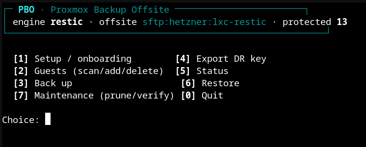
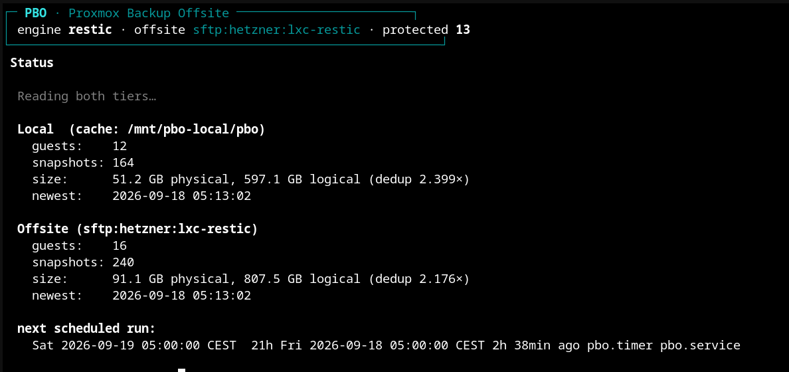

# pbo

This backs up Proxmox guests (LXC and QEMU) to an SFTP server using
[restic](https://restic.net/). That's it. It is not trying to be Proxmox Backup
Server, and if PBS works for you, go use PBS.

The point is an encrypted offsite copy without standing up yet another server for it.
restic already does dedup, encryption and incremental backups over plain SFTP, so pbo
is mostly glue: it runs `vzdump`, throws the archive into a restic repo, and pushes it
offsite. Restore does the reverse and feeds the archive to `pct restore` or
`qmrestore`, always into a new VMID. No daemon, no web service. Drive it from
`pbo menu`, or use the individual commands if you'd rather type.

> This is beta. It backs up and restores real machines and there's a test suite, but
> things still move around, so don't make it the only copy of anything important just
> yet.

## Screenshots

A quick look at the interface before you clone it. The main menu:



And the status screen, showing both tiers with the next scheduled run:



## Why restic

restic already solved the hard parts, so there's no reason to reinvent them. It speaks
SFTP itself, so there's no FUSE mount and no rclone in the middle. Everything goes into
one repo no matter how many guests or nodes you have. The repo password is both the
encryption key and the recovery key, so if you lose it the data is gone for good. Keep
a copy somewhere safe.

## Requirements

Nothing exotic:

- A Proxmox host (`pct`, `qm`, `vzdump`).
- `restic`, `jq`, `zstd`, `flock`, `curl`. `install.sh` installs whatever's missing.
- An SFTP target you can log into with a key. Storage Box paths are relative because the
  account is chrooted, which is expected.

## Install

```bash
git clone https://github.com/TubalQ/PBO
cd PBO
sudo ./install.sh
```

Goes into `/usr/local` and offers to run setup. It leaves the timer off, so it won't
start a nightly job you didn't ask for.

Or use the package from a [release](https://github.com/TubalQ/PBO/releases) (built by
CI, `packaging/build-deb.sh` builds the same locally):

```bash
apt install ./pbo_<version>_all.deb    # pulls restic, jq, zstd, ...
pbo setup
```

It installs to `/usr/lib/pbo`, ships the timers disabled, and leaves `/etc/pbo` alone
on purge (the DR key lives there). Releases are signed tags; see `CHANGELOG.md`.

## Quick start

```bash
pbo setup     # everything, in one pass
```

`setup` is a single guided pass that gets you from a clean clone to running backups.
It generates an SSH key if you don't have one and shows you how to install it on the
target, pins the target's host key, tests the SFTP connection before it commits
anything, writes `/etc/pbo/config`, creates the repo, sets retention, confirms which
guests to back up, and offers to enable the timers (nightly backup + weekly prune).

The one thing it can't do for you is get the public key onto the target — it prints the
key and the exact command, you run that once, and the connection test confirms it took.

Afterwards, export the DR key somewhere safe (`pbo menu` → Export DR key). Don't skip
that: it's the only thing that can decrypt the offsite data.

If you'd rather enable the schedule by hand instead of from the wizard:

```bash
systemctl enable --now pbo.timer         # backups, 05:00 daily
systemctl enable --now pbo-prune.timer   # prune, Sunday 06:30
```

Then `pbo doctor` any time to check the repo is reachable, the timer is on, the
DR key is 0600, the last integrity check passed, the config has no unknown keys, and
every guest has a recent snapshot.

## Notifications

Failures alert, success stays quiet unless `NTFY_ON_SUCCESS=true`. Two ways out:

- **Proxmox's notification system** (default when no ntfy is set up). pbo hands its
  events to the same targets and matchers as the cluster's own alerts, so they end up
  wherever those go: mail, Gotify, a webhook. Failures are severity `error`, and every
  event has the fields `type=pbo` and `hostname=<node>`, so a matcher with
  `match-field exact:type=pbo` can route them separately. `install.sh` puts pbo's
  templates in `/etc/pve/notification-templates/default/` (cluster-wide).
- **ntfy**, with `NTFY_URL`/`NTFY_TOPIC` (or `/etc/ntfy.creds`).

`NOTIFY_PVE=true` uses both, `false` only ntfy. `pbo notify-test` sends one warning
through whatever is active, and `doctor` warns if nothing would alert at all.

## Per-guest policy

Set it on the guest in Proxmox, as tags (GUI, or `pct set <id> --tags "..."`), and it
follows the guest when it moves to another node:

| Tag | Effect |
|---|---|
| `pbo-skip` | Left out of the nightly run. `pbo backup <id>` still works, with a warning. `doctor` lists it as skipped. |
| `pbo-stop` | vzdump `--mode stop` for this guest, like `VZDUMP_STOP_VMIDS`. |
| `pbo-keep-daily-N` | Offsite retention for this guest. Any subset of daily/weekly/monthly/yearly; |
| `pbo-keep-weekly-N` | the rest come from `KEEP_OFFSITE_*`. |
| `pbo-keep-monthly-N` | |
| `pbo-keep-yearly-N` | |

The keep tags are copied into each snapshot (`keep=d30.m12`), and prune reads them
from there. So a janitor that can't see Proxmox applies them too, and they still hold
after the guest is destroyed. The newest snapshot decides: change a tag and it counts
from the next backup. A policy that adds up to nothing keeps the newest snapshot
rather than deleting them all. The cache tier stays on `KEEP_LOCAL`.

## Integrity checks

`restic check` alone only checks structure. Reading the data back is what catches
bit rot or a provider quietly losing a pack, and reading all of it over SFTP every
week is expensive. `pbo verify --scheduled` reads the next 1/`VERIFY_ROTATE` slice
each run instead, so with the default of 12 and the weekly `pbo-verify.timer` every
pack is read about once a quarter. A failed slice is read again next time. `doctor`
shows when the last verify ran and fails if it failed.

```bash
systemctl enable --now pbo-verify.timer   # Wed 10:00
```

On a janitor the same runs daily against local disk (`VERIFY_ROTATE=30`).

## Clusters

There's no cluster mode to set up. Install it on every node and each node backs up its
own guests into the same repo, the same way Proxmox's own backup jobs work. No
coordinator, no node reaching across to another over SSH.

```bash
sudo ./install.sh
pbo setup                            # same repo, same password
systemctl enable --now pbo.timer
```

With `BACKUP_ORDER=auto` each node works out its own guests. Move a guest to another
node and that node backs it up on the next run; restic tags snapshots by vmid, so the
history isn't lost.

A few things worth getting right:

- Use the same repo password on every node, in `/etc/pbo/restic-pass`. Keep it out of
  `/etc/pve`, since pmxcfs replicates that directory in cleartext, which defeats the
  point.
- To edit the config once instead of N times, put the non-secret parts in
  `/etc/pve/pbo/config` and let pmxcfs sync it. The local file still holds the password
  and wins on conflicts.
- Prune from one node only, since it takes an exclusive lock. Set `PRUNE_OWNER` to pin
  it to a node.

## Commands

```
pbo [global flags] <command> [arguments]

Global flags:
  --json              machine-readable output
  --dry-run           show what would happen, do nothing

Commands:
  setup                       setup wizard
  menu                        interactive prompt
  init                        create or verify the repo
  backup <vmid>               back up one guest
  run-schedule [--stream|--batch]   back up this node's guests
  status                      running jobs and lock holder
  doctor                      health check (repo, timer, key, alerts, verify, per-guest age)
  notify-test                 send a test alert through every active backend
  list [vmid]                 offsite archives
  usage                       repo size, dedup ratio, snapshot count
  fetch <vmid> <ts>           extract+verify a snapshot into the cache
  restore <vmid> <ts> --to N  restore to a new vmid
  verify [--scheduled]        restic integrity check (both tiers); --scheduled reads 1/N of the data
  prune [--if-owner] [--queue] apply retention (--queue: wait for a running backup)
  unlock                      clear a stale repo lock after a killed run
  rotate-key <file>           rotate the repo password to a new value
  test-restore <vmid>         restore to a throwaway vmid, boot, destroy
  backup-host                 back up this host's config + rebuild metadata
  restore-host <node> <ts> --to <dir> [--path <p>]   extract host files to a dir
```

## Backing up the host itself

`pbo backup-host` captures the Proxmox host's own configuration into the same
repo, tagged `type=host`, so a rebuild is not starting from a blank machine. It
stores a curated set of paths (`/etc/pve`, networking, `/etc/pbo`, systemd units,
cron, apt sources — see `HOST_BACKUP_PATHS`) plus collected rebuild metadata
(`pveversion -v`, the manual package list, storage and network layout). It is
manual, not part of the nightly schedule, and appears in `list`/`status`/the menu
like a guest under `host-<node>`.

SSH keys and the restic DR key are **deliberately excluded** (`HOST_BACKUP_EXCLUDES`):
a secret never belongs in the repo it protects, and the host must keep its own
offline copy of its keys. Restore is a file restore, never `pct restore`:

```bash
pbo restore-host <node> <ts> --to /var/tmp/dr          # extract everything
pbo restore-host <node> <ts> --to /var/tmp/dr --path /etc/pve   # one path
```

Nothing is written to live host paths; you review the extracted tree and copy
what you need back by hand.

## Modes

| Setting | Effect |
|---|---|
| `LOCAL_REPO=true`  | Keep a local repo, copy each snapshot offsite. Fast local restores. |
| `LOCAL_REPO=false` | Straight to SFTP. Barely touches local disk. |
| `BACKUP_MODE=stream` | One guest at a time (default). Low disk. |
| `BACKUP_MODE=batch`  | Dump everything to cache first, then upload, if it fits. |

## Disaster recovery

The point of a backup is the restore, so: the host is dead and you have a clean machine.
Install pbo, give it the same repo password (the DR key), and restore. It always
restores to a new VMID and won't overwrite a running guest. And since a backup you've
never tested isn't really a backup, `test-restore` runs the whole loop for you: it
restores a throwaway copy, boots it, and throws it away.

## Hardening

Plain SFTP has no append-only mode, so a compromised host can delete its own offsite
backups. Three things close that gap, in order of effort:

- **Provider snapshots.** Turn on your Storage Box's scheduled snapshots and set
  `STORAGE_BOX_SNAPSHOTS_CONFIRMED=true`. This is the real ransomware backstop: even if
  the host wipes the repo, the provider keeps read-only copies. `pbo doctor` warns until
  you've confirmed it.
- **Pin the host key.** Setup offers to pin it for you: it runs `ssh-keyscan` against
  the target, writes the key to `/etc/pbo/known_hosts`, and points the ssh command at it
  with `-o UserKnownHostsFile=... -o StrictHostKeyChecking=yes` instead of trust-on-first-
  use. Decline it and the connection falls back to `accept-new`.
- **Append-only repo.** The strong version: the host can add snapshots but can't
  delete any. Put a restic rest-server in `--append-only` mode in front of the storage,
  on a machine the host has no shell on, and let that machine do retention. See
  [Append-only offsite](#append-only-offsite) below.

Rotate the repo password with `pbo rotate-key` (or menu → Rotate DR key). restic keys
wrap the master key, so it's instant and re-encrypts nothing, but the old key stops
working, so export the new one immediately.

## Append-only offsite

Two machines. The Proxmox host backs up to a restic rest-server running with
`--append-only`, so it can write new snapshots and nothing else. A second box, the
janitor, holds the repo on its own disk and runs retention there. Take the host over
and you still can't touch what's already offsite.

On the storage box, run [rest-server](https://github.com/restic/rest-server) with
`--append-only --private-repos --tls` as its own user, then:

```bash
sudo ./install.sh --janitor --user restic   # no PVE needed
# edit /etc/pbo/config: RESTIC_OFFSITE_REPO=/srv/restic/<user>/<repo>
# repo password in /etc/pbo/restic-pass, owned by restic, 0400
runuser -u restic -- pbo doctor
systemctl enable --now pbo-janitor.timer    # daily: prune, verify, doctor
```

On the host, in `/etc/pbo/config`:

```bash
RESTIC_OFFSITE_REPO=rest:https://janitor:8000/<user>/<repo>
RESTIC_REST_USERNAME=<user>
RESTIC_REST_PASSWORD_FILE=/etc/pbo/rest-pass   # 0600
RESTIC_CACERT=/etc/pbo/janitor-ca.pem          # the server's cert, if self-signed
OFFSITE_APPEND_ONLY=true
```

The setting is not decoration. restic exits 0 when an append-only server refuses a
`forget`, so without it the host's prune would report success and remove nothing.
With it, the host prunes its cache only and leaves offsite to the janitor.
`rotate-key` adds the new key offsite but can't remove the old one, so it tells you
to finish that on the janitor.

`pbo doctor` on the host sends a delete for a key that can't exist and expects a
403. If the server would have accepted it, doctor fails: a host that thinks it's
protected and isn't is worse than one that knows. On the janitor, doctor checks the
newest snapshot of every guest in the repo, so a host that stops sending shows up
on a machine it can't reach, and fails if any repo file isn't owned by the server's
user (run manual janitor commands with `runuser -u restic --`).

The janitor has the repo password and can delete everything. Lock it down
accordingly: nothing inbound but the rest-server port, from the hosts only. And put
it somewhere else. A janitor in a container on the host it protects protects nothing:
root on the host is root in the container. Use one only for testing.
Design notes: [ADR 0004](docs/adr/0004-append-only-offsite-and-janitor.md).

## Configuration

Everything is documented in `etc/config.example`. The only secret is the repo password
(`RESTIC_PASSWORD_FILE`, 0600). The config file itself holds nothing sensitive, so it's
fine to keep in version control.

## Contributing

Patches welcome. It's plain bash with tests in `tests/`. If you change how something
behaves, please add a test that covers it. `bash tests/all.sh` runs against mocks and
local repos. `tests/integration/pve.sh` runs the real thing on a Proxmox host:
throwaway CT and VM, backup, restore, boot, compare, prune, verify, and with
`PBO_IT_JANITOR_CT`/`PBO_IT_JANITOR_URL` the whole append-only path. It cleans up
after itself and only touches guests it created. `packaging/release.sh` runs it
before tagging when it's on a Proxmox host. Security issues: see
[SECURITY.md](SECURITY.md).

## License

AGPL-3.0-or-later. See `LICENSE`.
